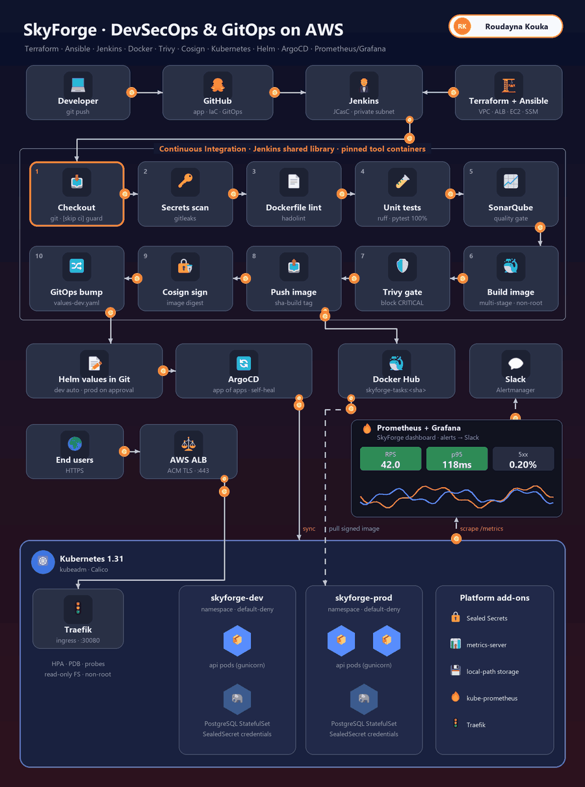
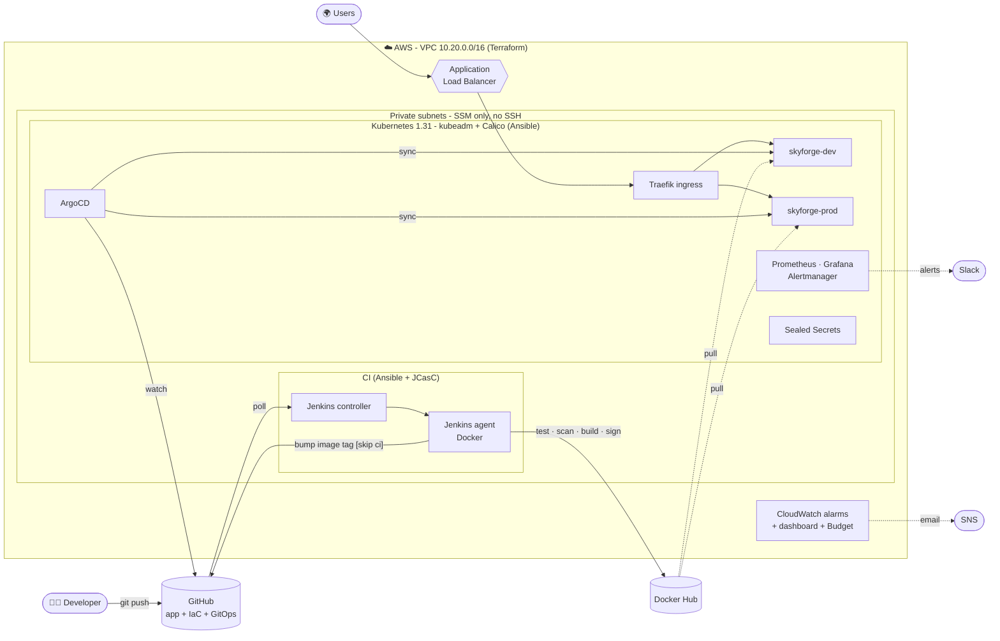
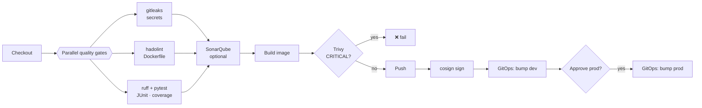

<div align="center">

# ☁️ SkyForge

### End-to-end DevSecOps & GitOps platform on AWS

**Terraform · Ansible · Jenkins · Docker · Kubernetes · Helm · ArgoCD · Prometheus · Grafana**

[](https://github.com/__GITHUB_USER__/skyforge/actions/workflows/ci.yml)
[](LICENSE)


*From `git push` to production in minutes. Tested, scanned, signed, versioned in Git and monitored.*

</div>

---

## 📌 Overview

SkyForge is a complete cloud platform that I designed and built to practice production-grade DevOps engineering.
One `git push` on the application triggers a pipeline that:

1. **Tests** the code and scans it for secrets and Dockerfile issues (in parallel),
2. **Builds** a minimal, non-root container image and **blocks** it if Trivy finds a critical CVE,
3. **Pushes** and **signs** the image (cosign),
4. **Commits** the new version to Git, where **ArgoCD** picks it up and deploys it to `dev`,
5. Waits for a **manual approval**, then promotes the same image to `prod`.

The whole infrastructure (network, servers, CI server, Kubernetes cluster, add-ons, dashboards, alerts) is **code**.
It can be rebuilt from scratch with a few `make` commands and destroyed just as easily.

> The workload is **SkyForge Tasks**, a small Flask + PostgreSQL REST API with a web UI, health probes and Prometheus metrics.

---

## 🏗️ Architecture

<div align="center">
  
  <br>
  <sub>Animated diagram generated as code: <a href="docs/images/make_architecture_gif.py">docs/images/make_architecture_gif.py</a></sub>
</div>

<details>
<summary><b>Detailed component diagram (Mermaid)</b></summary>



</details>

More diagrams and the reasoning behind each choice (ADRs) are in **[docs/architecture.md](docs/architecture.md)**.

---

## ✨ Highlights

| Area | What is implemented |
|---|---|
| **Infrastructure as Code** | Terraform modules (`network`, `alb`, `compute`, `monitoring`), remote state in an encrypted, versioned S3 bucket with native locking, input validation, default tags |
| **Secure networking** | Private subnets + NAT, ALB as the only public entry point, **no SSH / no port 22**: admin access via **AWS SSM**, IMDSv2 enforced, encrypted gp3 volumes, VPC flow logs |
| **Configuration management** | Ansible roles with a dynamic EC2 inventory over SSM, idempotent kubeadm bootstrap, Ansible Vault for secrets |
| **CI as code** | Jenkins fully configured by code: plugins list, **JCasC**, Job DSL seed job, **shared library** stored in this repo, SSH agent with a pinned host key |
| **DevSecOps** | gitleaks, hadolint, ruff, pytest (100 % coverage), optional SonarQube, **Trivy gate before push**, **cosign signing**, Checkov on Terraform, Dependabot |
| **Containers** | Multi-stage Dockerfile (test stage exports JUnit + coverage), non-root user, gunicorn, healthcheck, OCI labels |
| **Kubernetes** | Helm chart with HPA, PDB, probes, resource limits, `readOnlyRootFilesystem`, dropped capabilities, **default-deny NetworkPolicies** (enforced by Calico), PostgreSQL StatefulSet |
| **GitOps** | ArgoCD **App of Apps**, sync waves, two AppProjects (platform vs app), `dev` auto-deploy → `prod` approval gate, rollback = `git revert` |
| **Secrets** | Ansible Vault (infra), JCasC secret files (Jenkins), **Sealed Secrets** (Kubernetes): nothing is stored in plaintext in Git |
| **Observability** | Prometheus metrics in the app, ServiceMonitor, PrometheusRules (down / error rate / latency), Grafana dashboard as code, Alertmanager → Slack, CloudWatch alarms → email |
| **FinOps** | AWS Budget alerts, one-command `make destroy`, documented hourly cost |
| **Developer experience** | `make help`, Dev Container with every tool, `docker compose` local stack, pre-commit hooks, GitHub Actions quality gates |

---

## 🔁 CI/CD pipeline



- **Jenkins** ([jenkins/Jenkinsfile](jenkins/Jenkinsfile)) uses the in-repo **shared library** ([jenkins/shared-library/vars](jenkins/shared-library/vars)). Every tool runs as a **pinned container image**, so the agent only needs Docker.
- **GitHub Actions** ([.github/workflows/ci.yml](.github/workflows/ci.yml)) runs the same checks on every pull request, plus `terraform validate`, Checkov, ansible-lint, Helm lint, kubeconform and shellcheck.
- Images are tagged `<git-sha>-<build>`. The `:latest` tag is never deployed.

---

## 🔐 Security by design

| Threat | Mitigation |
|---|---|
| Leaked credentials in Git | gitleaks in pre-commit, CI and Jenkins. Secrets are kept in Ansible Vault, JCasC secret files and SealedSecrets |
| Vulnerable image in production | Trivy gate **before** push, weekly Dependabot updates, slim base image |
| Tampered image | cosign signature on the image digest |
| Exposed management ports | No public IPs on nodes, no SSH, SSM sessions audited in CloudTrail, Jenkins reachable only from `admin_cidrs` |
| Credential theft via SSRF | IMDSv2 required |
| Lateral movement in the cluster | Default-deny NetworkPolicies: only ingress → API and API → PostgreSQL are allowed |
| Container breakout | Non-root, read-only root FS, `drop: [ALL]`, `seccompProfile: RuntimeDefault`, no service-account token |
| Unreviewed infra changes | Checkov + `terraform validate` on every PR, and each accepted risk is documented in [.checkov.yaml](.checkov.yaml) |

---

## 📊 Observability

- **Application**: `/metrics` exposes request count, latency histogram and business counters. `/healthz` (liveness) and `/readyz` (checks the database).
- **Prometheus rules**: `SkyForgeDown`, `SkyForgeHighErrorRate` (> 5 % 5xx), `SkyForgeHighLatency` (p95 > 500 ms) → **Alertmanager → Slack**.
- **Grafana**: the dashboard is shipped with the Helm chart ([helm/skyforge/dashboards](helm/skyforge/dashboards)). It shows RPS, error ratio, p50/p95/p99 latency, and CPU and memory per pod.
- **AWS**: CloudWatch dashboard, plus alarms for CPU, status checks, ALB 5xx and unhealthy targets, sent by **SNS → email**.

<!-- After your first deployment, add screenshots here (Jenkins pipeline, ArgoCD tree, Grafana dashboard, the app) - recruiters love them:
  
-->

---

## 📁 Repository structure

```text
.
├── app/                     Flask API + UI, tests, multi-stage Dockerfile, docker-compose
├── terraform/
│   ├── bootstrap/           S3 remote-state bucket (run once)
│   └── modules/             network · alb · compute · monitoring
├── ansible/
│   ├── inventory/           dynamic EC2 inventory (SSM) + group_vars + vault example
│   ├── playbooks/           site · jenkins · kubernetes · kubeconfig
│   └── roles/               common · docker · jenkins_controller · jenkins_agent
│                            k8s_common · k8s_control_plane · k8s_worker · argocd
├── jenkins/
│   ├── Jenkinsfile
│   └── shared-library/vars/ reusable pipeline steps
├── helm/skyforge/           application chart + values-dev / values-prod
├── argocd/
│   ├── bootstrap/           AppProjects + root Application (app of apps)
│   ├── apps/                one Application per add-on / environment
│   └── platform/            add-on values and sealed secrets
├── scripts/                 init-repo · seal-secrets
├── docs/                    architecture (ADRs) · runbook
├── .github/                 CI workflow + Dependabot
├── .devcontainer/           toolbox (Terraform, Ansible, kubectl, helm, kubeseal, AWS CLI)
└── Makefile                 make help
```

---

## 🚀 Getting started

### Run the application locally (2 minutes)

```bash
cd app
docker compose up --build        # http://localhost:5000
# or without Docker
pip install -r requirements-dev.txt && pytest
```

### Deploy the whole platform on AWS

```bash
make init GITHUB_USER=<you> DOCKERHUB_USER=<you>   # personalize the repo
make bootstrap                                     # remote state (once)
make infra                                         # Terraform: VPC, ALB, EC2, IAM, alarms
make deps configure                                # Ansible: Jenkins, Kubernetes, ArgoCD
make kubeconfig && make tunnel                     # kubectl access through SSM
make seal-secrets                                  # DB / Grafana / Slack secrets → Git
make urls                                          # app + Jenkins URLs
```

📖 The step-by-step guide, day-2 operations and troubleshooting are in **[docs/runbook.md](docs/runbook.md)**.

> 💸 **Cost**: about $0.28/hour (≈ $7/day) while running. Run `make destroy` when you are done.

---

## 🧠 Challenges & lessons learned

- **Jenkins without clicks.** Making Jenkins reproducible meant combining the plugin manager, JCasC, a secrets directory and a Job DSL seed job. Now the controller can be thrown away and rebuilt identically.
- **Avoiding CI loops in GitOps.** The pipeline commits back to the repository it watches. Commits tagged `[skip ci]` and a guard stage prevent infinite builds, and pushes retry with a rebase when they race.
- **Accessing private nodes.** Moving everything to private subnets meant Ansible (SSM connection plugin with an S3 transfer bucket) and `kubectl` (SSM port forwarding plus an extra API-server certificate SAN for `127.0.0.1`) had to work without SSH.
- **NetworkPolicies that actually work.** Flannel silently ignores them, so I switched to Calico to make the default-deny policies effective.
- **Ordering cluster add-ons.** CRDs, StorageClass, secrets and the ingress must exist before the app. ArgoCD sync waves only order child Applications once Application health checks are re-enabled.

---

## 🗺️ Roadmap

- [ ] EKS variant of the compute layer (managed control plane, IRSA, External Secrets)
- [ ] Centralized logs with Loki + Grafana Alloy
- [ ] Policy enforcement with Kyverno (only signed images, required labels and limits)
- [ ] Progressive delivery (canary) with Argo Rollouts
- [ ] AWS WAF on the ALB

---

## 👩‍💻 Author

**Roudayna Kouka**, Cloud & DevOps engineer

Designed, built and documented end to end: infrastructure, automation, CI/CD, Kubernetes, security and observability.

⭐ If this project helped you, consider giving it a star!

<sub>Licensed under the [MIT License](LICENSE).</sub>
