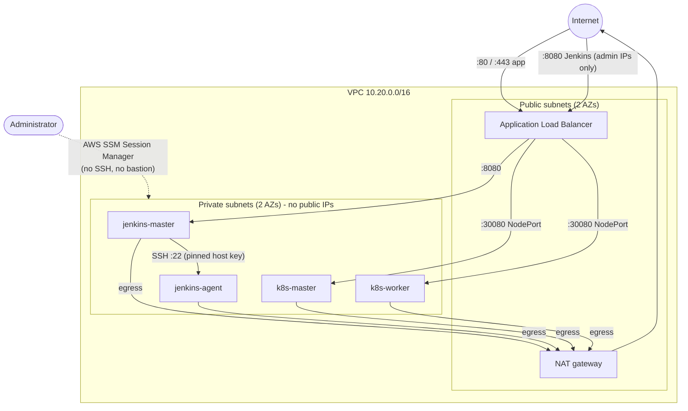
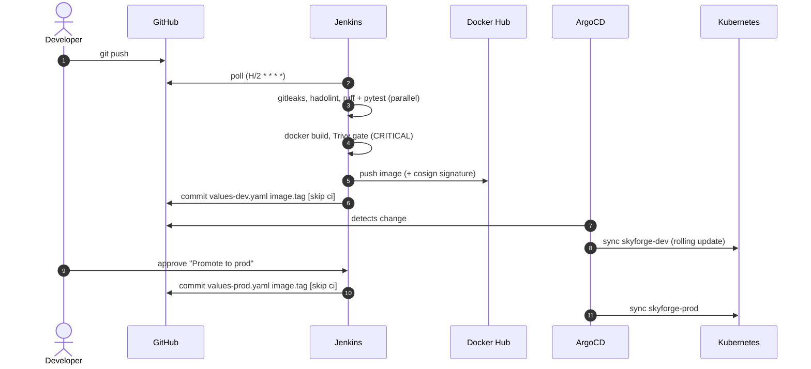

# Architecture & design decisions

This page explains **why** SkyForge is built the way it is. Each decision lists the
alternatives that were considered and the trade-off accepted.

## Network layout

| Security group | Inbound |
|---|---|
| `alb` | 80 (and 443 with a domain) from anywhere, 8080 from `admin_cidrs` only |
| `jenkins` | 8080 from the ALB SG, 22 from itself (controller → agent) |
| `k8s` | everything from itself (API, kubelet, Calico), 30080 from the ALB SG |

No security group allows port 22 from the internet. Ansible, `kubectl` and the
ArgoCD and Grafana UIs all go through SSM port forwarding.

## Decisions

### ADR-1: Private nodes with SSM instead of a bastion or public SSH
- **Chosen**: private subnets, `AmazonSSMManagedInstanceCore` instance profile, and Ansible's `aws_ssm` connection.
- **Alternatives**: public IPs with SSH limited to one IP, or a bastion host.
- **Why**: no inbound management port, no SSH keys to rotate, and every session is logged in CloudTrail.
- **Cost**: a NAT gateway (~$32/month) and an S3 bucket for Ansible file transfers. Ansible runs are slower than over SSH.

### ADR-2: kubeadm cluster instead of EKS
- **Chosen**: a self-managed kubeadm cluster (one control plane, one worker) with Calico.
- **Why**: it shows how Kubernetes works under the hood (control plane bootstrap, CNI, certificates, node join) and costs less than EKS's control plane fee.
- **Trade-off**: there is a single control plane, so it is not highly available. Upgrades are manual (`kubeadm upgrade`). EKS is the production answer and is listed in the roadmap.

### ADR-3: Calico rather than Flannel
- Flannel does not enforce `NetworkPolicy`. Calico does, which makes the namespace-level default-deny policies in the Helm chart actually effective.

### ADR-4: Jenkins for CI, ArgoCD for CD (GitOps)
- **Chosen**: Jenkins builds, tests, scans and pushes the image, then commits the new tag to `helm/skyforge/values-<env>.yaml`. ArgoCD reconciles the cluster from Git.
- **Why**: the CI system never holds cluster credentials. Git is the audit log of every deployment, and a rollback is `git revert`. ArgoCD self-heals manual drift.
- **Alternative**: ArgoCD Image Updater. It was rejected because the explicit commit shows exactly which tag was promoted, and when.

### ADR-5: Everything as code, including Jenkins
- **Chosen**: Jenkins is configured entirely by Ansible: plugins (`plugins.txt`), JCasC (security, agent, credentials, shared library), and a Job DSL seed job. Secrets are files under `casc-secrets/` and never appear in `jenkins.yaml`.
- **Why**: rebuilding the controller from scratch gives the same Jenkins. Nobody clicks around in the UI.

### ADR-6: Sealed Secrets for Kubernetes secrets
- **Chosen**: Bitnami Sealed Secrets. Secrets are encrypted with the cluster's public key and committed to Git.
- **Alternative**: External Secrets + AWS Secrets Manager. It is a good fit on EKS with IRSA, but heavier to run on a kubeadm cluster without workload identity.

### ADR-7: TLS at the ALB edge (ACM)
- **Chosen**: when `domain_name` is set, Terraform issues an ACM certificate (DNS-validated in Route53) and the ALB terminates HTTPS.
- **Alternative**: cert-manager with Let's Encrypt inside the cluster. It would need a TCP pass-through load balancer (NLB), so it was not chosen.

### ADR-8: Terraform state in S3 with native locking
- **Chosen**: an S3 bucket that is versioned, KMS-encrypted and blocks public access, with `use_lockfile = true` (Terraform ≥ 1.10).
- **Why**: the DynamoDB lock table is deprecated by HashiCorp. S3 lock files give the same safety with one resource less.

## Delivery flow

## Cluster add-ons (App of Apps)

| Sync wave | Application | Purpose |
|---|---|---|
| -4 | `sealed-secrets` | Decrypts SealedSecrets committed to Git |
| -4 | `local-path-provisioner` | Default StorageClass (PostgreSQL, Prometheus) |
| -4 | `metrics-server` | Resource metrics for the HPA |
| -3 | `monitoring-secrets` | Grafana admin and Slack webhook SealedSecrets |
| -2 | `kube-prometheus-stack` | Prometheus, Alertmanager → Slack, Grafana |
| -1 | `traefik` | Ingress controller on NodePort 30080 |
| 0 | `skyforge-dev`, `skyforge-prod` | The application (Helm chart) |
